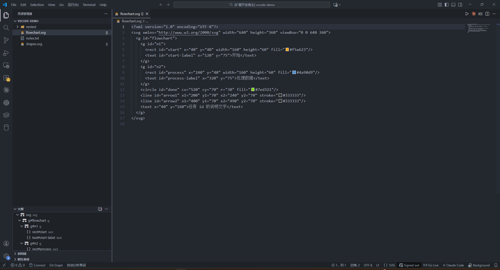

# SVG Editor · PJ1（Phase 1 + Phase 2）

TypeScript 面向对象实现的可扩展 SVG 编辑器：Phase 1 提供 CLI、六类图形、嵌套容器、SVG 读写和命令级撤销重做；Phase 2 在同一仓库上增加四个扩展点、插件装配、`box` 图形、结构树标签，以及 VSCode 的 SVG 文件标记和原生 Outline 扩展。

- [项目文档：扩展点、装配方式、架构、ADR、AI 协作检查](doc/README.md)
- [Phase 2 测试与验证材料](docs/submission.md)
- [Phase 2 指标报告](docs/metrics/generated.txt)
- [Phase 1 任务说明](phase_cli_1.md)
- [CLI 完整示例脚本](examples/flowchart.commands) · [生成的 SVG](examples/flowchart.svg)

## 功能

**CLI（Phase 1）**

- 六类图形：`rect`、`circle`、`ellipse`、`line`、`text`、`g`；支持嵌套容器、`in` 子句、`move`/`scale`、`group`/`ungroup`/`addto`、`front`/`back`。
- `init`/`read`/`save`/`canvas`、`set`、`delete`、`tree`/`show`/`help`、`undo`/`redo`。
- 命令级快照事务；IO 命令后清空历史；SVG 读写、ID 分配和错误回滚。

**插件（Phase 2）**

- 四个内核侧扩展点：`ShapeProvider`、`CommandPlugin`、`TreeDecorator`、`AttributeHandler`。
- `plugins/stats.ts`：按图形类型统计叶子，单独统计容器。
- `plugins/dir.ts`：通过 `DirectoryAccess` 适配器列出当前工作目录。
- `plugins/box.ts`：`create box`、`set fill`/`set label`、`data-kind="box"` 持久化、读回校验和未装插件时的 `g` 降级。
- `plugins/tree-star.ts`：`modified-star`，按“内容是否偏离上次保存/读入”标记 `*`，并传播到祖先行；与 `(box)` 标签并存。
- 同一个插件既可由组合根代码装配，也可由 `plugins.config.json` 配置装配；加载器负责 manifest 校验、重复注册、失败回滚和 `error:` 输出。

**VSCode 扩展**

- Explorer 中只为 `.svg` 文件显示 `[]` badge，非 SVG 文件和目录不显示。
- 原生 Outline 展示 SVG 元素嵌套层级：有 id 显示 `tag#id`，无 id 显示标签名；点击定位源码，编辑后更新，不完整 XML 返回空大纲而不崩溃。



*真实的 Extension Development Host 运行截图；更多 badge / Outline 特写见 [docs/submission.md](docs/submission.md)。*

## 运行

需要 Node.js 22 或更新版本。项目根目录：

```sh
npm ci
npm run cli
```

```text
svg> init 800 600
svg> create g scene
svg> create rect r1 10 20 100 50 #4a90d9 in scene
svg> create text t1 30 50 "Hello SVG" in scene
svg> move scene 20 10
svg> undo
svg> tree
svg> save demo.svg
svg> exit
```

配置装配（加载 `box`、`stats`、`dir`、`tree-star`）：

```sh
npx tsx src/main.ts --config plugins.config.json
```

```text
svg> create box b 0 0 50 20 "Hi"
svg> set b fill red
svg> set b label "Hello"
svg> stats
svg> tree
```

执行脚本或运行编译版本：

```sh
npm run cli < examples/flowchart.commands
npm run build
node dist/main.js
```

## VSCode 扩展

```powershell
cd extension
npm install
npm run compile
cd ..
code --new-window --extensionDevelopmentPath=".\extension" ".\examples\vscode-demo"
```

`examples/vscode-demo/.vscode/settings.json` 中的 `svgOutline.demo` 只用于可复现截图：让扩展把 SVG 以文本编辑器打开并聚焦/展开 Outline；正常使用时保持默认 `false`。

## 验证

```sh
npm run check           # build + typecheck(src/plugins/tests) + 94 项 CLI 测试
npm run check:extension # extension 编译 + 6 项 Outline 测试
npm run test:coverage   # CLI 覆盖率
npm run metrics         # 生成 docs/metrics/generated.txt
```

当前结果：**CLI 94 / 94 通过，VSCode 扩展 6 / 6 通过**。测试覆盖 Phase 1 回归、四个扩展点、加载器失败与回滚、`dir` 适配器、`box` 读写/降级/不变量、`modified-star` 状态机、属性处理器事务，以及代码/配置双装配逐字节一致。

默认装配不加载可选插件，Phase 1 的命令、六种图形和输出保持不变；`create box` 只有在加载 `box` 插件后可用。path、defs/use、完整 SVG 标准支持和全局 transform 换算仍不在范围内，详见 [doc/README.md](doc/README.md)。

## 目录

| 目录 | 内容 |
|---|---|
| `src/` | CLI 内核：domain、commands、application、cli、infrastructure、presentation、plugin 契约与加载器 |
| `plugins/` | `box`、`stats`、`dir`、`tree-star` 插件 |
| `extension/` | VSCode 扩展：badge、Outline provider、纯解析模块与测试 |
| `test/` | CLI 与插件测试，含双装配一致性测试 |
| `examples/` | Phase 1 回放脚本、SVG 示例、VSCode 演示工作区 |
| `doc/` | 扩展点、架构、ADR、AI 协作记录 |
| `docs/` | 提交材料、运行截图、指标报告 |
| `scripts/` | 指标生成脚本 |

## 提交

远程仓库：[mmjzmy/svg-editor-pj1](https://github.com/mmjzmy/svg-editor-pj1)（公开）。

- `final`：Phase 1 最终提交。
- `p2`：Phase 2 最终提交，包含 VSCode 扩展、四个扩展点、插件、测试、文档和截图。
- 开发历史按“工程骨架 → 图形/命令/IO → Phase 2 框架 → 命令插件 → box → 标签 → 装配 → 测试 → 文档/指标”拆分，可用 `git log --oneline final..p2` 查看。
