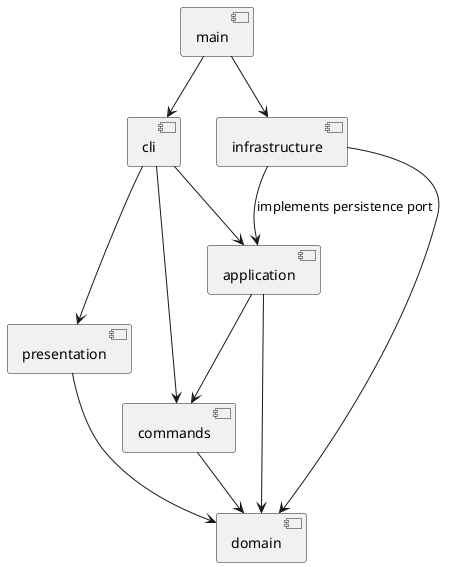

# PJ1 Phase 1 项目文档

## 架构方案

初始方案：TypeScript，采用 Command + Composite + Memento，领域对象不接触终端或文件系统。

| 模块 | 职责 |
| --- | --- |
| `src/domain/` | 图形多态、树结构、几何及属性校验、文档结构操作 |
| `src/commands/` | 编辑命令对象与逐条撤销/重做 |
| `src/application/` | 当前文档、历史与文档 IO 用例；定义持久化接口 |
| `src/cli/` | 参数解析、命令分派、逐行交互 |
| `src/infrastructure/` | SVG XML 编解码和文件读写 |
| `src/presentation/` | 结构树与属性明细的纯显示 |
| `src/main.ts` | 依赖组装 |

依赖只允许从交互层指向用例与领域；领域不依赖上层；基础设施实现应用层的持久化接口。图形类型名分派集中在 ShapeFactory，命令名分派集中在 CommandDispatcher。这两处注册表是后续插件化时的待重构点，本阶段不加载插件。

变化点假设：新增图形通过 Shape 子类及工厂扩展；新交互通道复用命令和用例；替换文件存储通过持久化接口；大型文档可能需要把整棵树快照改成增量撤销，本阶段优先简单可靠。

## 过程记录

2026-10-24：从任务原文确认 TypeScript、Command 模式、Composite、IO 历史屏障和根级容器不可解组等约束。AI 参与方案梳理、实现及验证，本文只保留关键迭代摘要，不虚构人工完成比例。先提交方案与工程骨架，再逐步实现和测试。

## 一致性自查

待实现后按实际目录、依赖和测试结果补全。

## 质量保证手段

计划采用严格类型检查、自动化测试、完整命令脚本和 SVG 读写回环验证。失败命令必须同时保留文档和历史状态。
