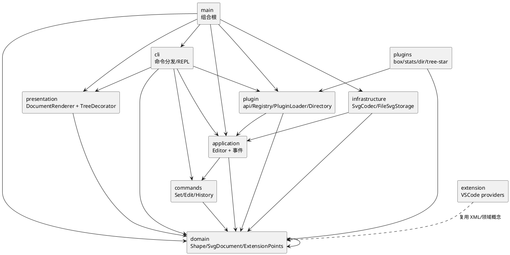
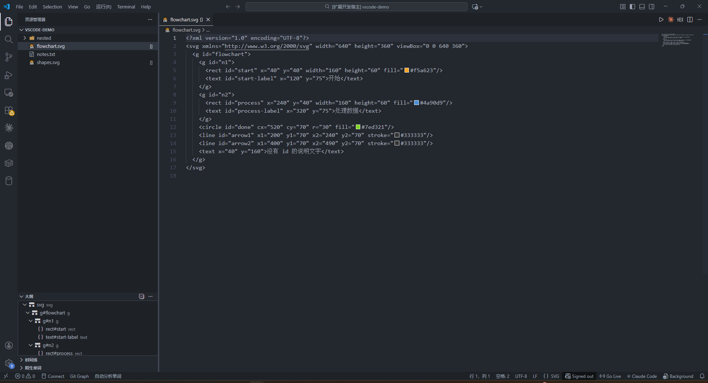
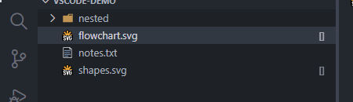
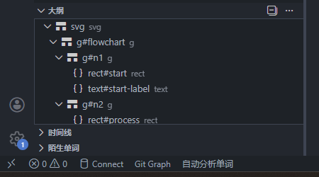
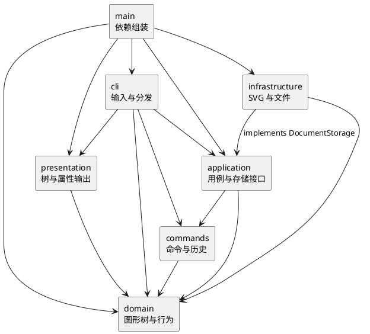

# PJ1：CLI SVG 编辑器（Phase 1 + Phase 2）

Phase 1 的架构与语义见下文；Phase 2 在同一仓库继续开发，最终提交打 tag `p2`，原 `final` 标签保持不变。

## Phase 2：插件实践与插件式重构

### 2.1 扩展点清单

| 扩展点 | 内核接口 | 职责 | 内核调用位置 | 本阶段实现 | 禁用可选插件时的缺省行为 | 违约或错误 |
|---|---|---|---|---|---|---|
| `ShapeProvider` | `src/domain/ExtensionPoints.ts` | 创建一种图形，并从 SVG 属性读回 | `ShapeFactory.create()`、`ShapeFactory.fromAttributes()` | `plugins/box/index.ts`；六种内置图形也在 `ShapeFactory` 构造器中通过同一个 `register()` 路径装配 | 六种 Phase 1 图形可用；`create box` 报 `error: unknown shape type: box (is the plugin loaded?)` | 重名 `error: duplicate registration: shapes/<name>`；未知类型 `error: unknown shape type: <type>`；读回校验失败则整次 `read` 失败 |
| `CommandPlugin` | `src/plugin/api.ts` | 增加一条 CLI 命令，自带 `usage` | `CommandDispatcher.execute()`；`help` 从注册表取 `usage` | `plugins/stats/index.ts` 的 `StatsCommand`、`plugins/dir/index.ts` 的 `DirCommand` | `CommandCatalog` 中的内置命令继续工作；未加载时 `error: unknown command: stats` | 重名 `error: duplicate registration: commands/<name>`；`execute` 抛错由 dispatcher 转成 `error:` |
| `TreeDecorator` | `src/domain/ExtensionPoints.ts` | 给结构树某一行追加标签 | `DocumentRenderer.tree()` 按注册顺序逐行调用 `decorate()` | `plugins/box/index.ts` 的 `BoxTypeLabel`；`plugins/tree-star/index.ts` 的 `ModifiedStarDecorator` | 不注册任何装饰器时，树输出与 Phase 1 逐字节一致 | 重名 `error: duplicate registration: decorators/<name>`；装饰器抛错时该 `tree` 命令报错，不输出半行结果 |
| `AttributeHandler` | `src/domain/ExtensionPoints.ts` | 为某类图形的某个属性定义领域语义 | `SetCommand.apply()`；`PluginRegistry.find()` | `plugins/box/index.ts` 的 `BoxFillHandler`、`BoxLabelHandler` | 回退到 Phase 1 属性白名单，例如普通 `rect` 可直接 `set fill` | 第一个匹配者生效；重名 `error: duplicate registration: attributes/<name>`；处理器抛错则整条 `set` 失败并回滚，不回退到默认处理 |

插件扩展点都用类或类实例实现：`BoxProvider`、`BoxFillHandler`、`BoxLabelHandler`、`BoxTypeLabel`、`StatsCommand`、`DirCommand`、`ModifiedStarDecorator`。每个插件目录的 `package.json` 用 `contributes` 声明提供哪些扩展（如 `plugins/box/package.json` 声明 `shapes: ["box"]`、`attributes: [...]`、`decorators: [...]`）；加载器读取模块最近的 `package.json`，内联/data URL 模块则回退到模块内 `manifest`。

#### ShapeProvider

`ShapeProvider` 的接口是：

```ts
export interface ShapeProvider {
  readonly name: string;
  create(id: string, params: string[]): Shape;
  fromAttributes?(id: string, attributes: Record<string, string>, text: string): Shape;
}
```

`ShapeFactory` 仍保留六种 Phase 1 图形的构造定义，但新增 `register(provider)`、`has(type)`、`snapshot()`、`restore()`。`create` 与 `fromAttributes` 只查注册表，不认识任何具体插件。`box` 插件注册一个 provider；`Box` 继承 `Group`，`fromAttributes` 返回空 `Box`，由 codec 递归挂上子元素，最后调用 `Shape.afterRead()` 校验不变量。

#### CommandPlugin

```ts
export interface CommandPlugin {
  readonly name: string;
  readonly usage: string;
  execute(editor: Editor, args: string[]): string | Promise<string>;
}
```

`CommandDispatcher` 先查 `CommandCatalog` 的内置命令，再查 `PluginRegistry.commands`；`help` 拼接内置 `usage` 与插件 `usage`。内置命令在构造时通过 `CommandCatalog.register` 装配，插件命令通过 `PluginRegistry.registerCommand` 装配。`stats` 与 `dir` 都是独立插件，内核没有针对命令名的分支。`dir` 的 `execute` 只依赖 `DirectoryAccess`，不直接依赖 `node:fs`。

#### TreeDecorator

```ts
export interface TreeDecoratorContext {
  readonly document: SvgDocument;
  readonly isRoot: boolean;
}
export interface TreeDecorator {
  readonly name: string;
  decorate(shape: Shape, line: string, context: TreeDecoratorContext): string;
}
```

`DocumentRenderer.tree(document, id?, decorators)` 对根行和每个子节点行按注册顺序调用装饰器。没有装饰器时 `decorators` 为空数组，输出与 Phase 1 完全一致。`box` 插件用 `box-type-label` 给 `Box` 行追加 `(box)`；`tree-star` 插件用 `modified-star` 追加 `*`。两个标签互不感知，顺序由 `plugins.config.json` 的加载顺序决定（本仓库为 box 先、tree-star 后，因此是 `g#b (box) *`）。

`modified-star` 的状态封装在装饰器实例字段中，不使用模块级变量：

- 基线为“上次成功 `init`/`read`/`save` 时”的 `id -> 内容签名` 映射，根行另有宽高、根属性与根子树的签名。
- 内容签名递归包含子节点，因此子图形修改时祖先容器行也会出现 `*`。
- `undo` 回到保存点时签名与基线一致，`*` 消失；`redo` 后再次出现。
- 新建但未保存的节点不在基线中，显示 `*`；`save` 成功后基线刷新，`*` 消失。
- 装饰器实例之间独立；`test/tree-decorator.test.ts` 覆盖保存、编辑、撤销、重做、祖先传播和子树根。

#### AttributeHandler

`SetCommand.apply()` 先调用 `handlers.find(handler => handler.handles(shape, attr))`；命中则只调用该处理器的 `apply()`，未命中才执行 Phase 1 的 `shape.setAttribute()`。处理器通过公开的 `Shape` 接口访问图形，例如 `box` 用 `instanceof Box` 判断类型，按 `id` 查找 `<id>-rect` 与 `<id>-label`，不读取私有字段。

事务语义由 `EditCommand` 提供：命令在文档副本上执行，只有全部成功后才替换当前文档并入 `CommandHistory`。因此：

- 一次 `set` 是一个 undo 单元；
- 处理器在中途修改多个子部件后抛错时，候选文档整体丢弃，当前文档、undo/redo 历史不变；
- 处理器失败后不再回退到默认属性处理，避免重复修改或掩盖错误；
- 多个处理器同时命中时按注册顺序取第一个，测试固定了这一规则。

### 2.2 两种装配方式

两种方式共用 `PluginLoader.activateModule()`、`PluginContext`、`PluginRegistry` 与同一个插件实例创建路径，差别只在最外层由谁实例化。

**方式 A：代码装配。** 在组合根直接调用加载器：

```ts
const factory = new ShapeFactory();
const registry = new PluginRegistry();
const editor = new Editor(new FileSvgStorage(new SvgCodec(factory)));
const loader = new PluginLoader(factory, registry, editor);
await loader.load({ module: './plugins/box/index.ts' });
await loader.load({ module: './plugins/tree-star/index.ts' });
```

`load()` 负责动态导入，`loadModule()` 可直接接收已经导入的 `PluginModule`；两者都进入同一个 `activateModule()`，执行清单校验和回滚。`test/plugin.test.ts`、`test/assembly.test.ts` 使用这条路径。代价是新增插件要改组合根并重新构建，但类型检查完整、调试直接。

**方式 B：配置装配。** 仓库根 `plugins.config.json`：

```json
{
  "plugins": [
    { "module": "./plugins/box/index.ts" },
    { "module": "./plugins/stats/index.ts" },
    { "module": "./plugins/dir/index.ts" },
    { "module": "./plugins/tree-star/index.ts" }
  ]
}
```

启动时 `npx tsx src/main.ts --config plugins.config.json`。相对模块路径以配置文件目录为基准；`enabled: false` 完全跳过；`options` 原样传给 `activate(context, options)`。`dir` 的 `options.cwd` 仅用于测试/演示固定目录，默认仍是 CLI 进程的 `cwd`。两种方式对固定目录执行 `dir` 的输出逐字节一致，见 `test/dir.test.ts`；一个包含 `box`、`stats`、`dir`、`tree`、`save` 的混合会话在两种方式下也逐字节一致，见 `test/assembly.test.ts`。

每个插件目录的 `package.json` 用 `contributes` 声明扩展，例如 `plugins/box/package.json`。加载器从被加载模块最近的 `package.json` 读取声明与包名；`loadModule()`/data URL 等内联模块没有 package.json 时回退到模块 `manifest`。两条路径最终都进入 `activateModule()` 的清单比对和回滚。

加载器失败路径：

| 失败 | 输出 |
|---|---|
| 模块找不到 | `error: plugin not found: <module>` |
| 没有默认导出 | `error: plugin has no default export: <module>` |
| `contributes`/manifest 与实注册不一致 | `error: plugin manifest mismatch: <name> (declared: …; registered: …)` |
| `activate` 抛错 | `error: plugin failed to activate: <name> (<reason>)` |
| 注册名重复 | `error: duplicate registration: <category>/<name>` |
| 配置语法或结构不合法 | `error: invalid plugin config` |
| 模块存在但求值/依赖失败 | `error: plugin failed to load: <module> (<reason>)` |

所有失败都只回滚当前插件的暂存注册，保留已成功插件并继续后续加载，主程序不退出。`PluginLoader` 不导入任何具体插件包，只导入 `PluginContext`、`PluginRegistry`、`ShapeFactory` 和 `Editor` 类型；加载器独立性可用 `rg` 辅助检查。

`dir` 的适配器角色：

| 角色 | 本实现 |
|---|---|
| Target（目标接口） | `DirectoryAccess.list(path)`，位于 `src/domain/Directory.ts` |
| Adapter（适配器） | `FileSystemDirectoryAccess`，位于 `plugins/dir/index.ts`，把 `node:fs/promises.readdir` 适配为 `DirectoryEntry[]` |
| Client（客户端） | `plugins/dir/index.ts` 的 `dir` 命令 |
| Test Double | `test/dir.test.ts` 的 `fake(entries)`，与真实适配器实现同一接口 |

`DirectoryEntry` 分为 `directory`、`file`、`other`；目录在前、文件次之、特殊项最后，各组按名称升序。普通目录和文件分别显示 `[DIR]  <name>`、`[FILE] <name>`；符号链接等特殊项显示为 `[OTHER] <name>`，不跟随其目标。隐藏项包含，`.`/`..` 不列出；空目录输出 `(empty directory)`；读取失败输出 `error: cannot read directory: <path>`。

### 2.3 重构前后的架构变化

Phase 1 的两张“按名字分派”表（`CommandDispatcher`/`CommandCatalog` 的内置命令注册表、`ShapeFactory` 的图形注册表）保留为默认能力；Phase 2 在它们旁边增加了插件注册表与 `PluginLoader`：

| 位置 | Phase 1 | Phase 2 |
|---|---|---|
| 图形创建/读回 | 工厂内静态定义 | `ShapeFactory` 注册的 `ShapeProvider`，内置图形仍由构造器注册 |
| 命令分发 | 内置命令 `Map` | `CommandCatalog` 注册的内置命令 + `PluginRegistry.commands`，插件命令在未命中内置命令时查注册表 |
| 树输出 | `DocumentRenderer` 直接拼行 | 渲染器逐行调用 `TreeDecorator`，内核不感知 `(box)` 或 `*` |
| `set` | 直接 `shape.setAttribute` | `AttributeHandler` 先匹配，未命中才走 Phase 1 白名单 |
| 文档事件 | 无 | `Editor.on()` 发 `init/read/save/edit/undo/redo/canvas`，供 `modified-star` 维护基线 |
| 插件装配 | 无 | `src/plugin/` 的公开契约、注册表、加载器；`plugins/` 的实现；`plugins.config.json` |



依赖规则保持 Phase 1 的方向：`domain` 不依赖插件/文件/终端；`presentation` 只依赖 `domain`（`TreeDecorator` 接口放在 domain）；`cli` 可以依赖 `plugin` 注册表；`plugin` 只依赖公开的 domain/application 抽象；`plugins/` 依赖 `domain` 与 `plugin/api`；`main` 只做装配。`test/architecture.test.ts` 继续检查静态 import。

“接入插件不改内核”的检查方式：

```sh
git diff --name-status <接入提交>^ <接入提交> -- src plugins
git diff <接入提交>^ <接入提交> -- src/domain src/commands src/application src/presentation src/plugin ':!<本次新增插件目录>'
```

本次 `box`、`stats`、`dir`、`tree-star` 各自只新增 `plugins/*.ts`；加载器、渲染器、`SetCommand`、`ShapeFactory` 的通用改动已在框架提交中完成。`plugins.config.json` 的新增只改配置，不改运行代码。`PluginLoader` 的独立性检查：

```sh
rg -n "import|require|switch" src/plugin/PluginLoader.ts
```

加载器只有通用 import（`node:fs`、`node:fs/promises`、`node:module`、`node:path`、`node:url`、api/registry/factory/editor），没有具体插件名或分支。

### 2.4 VSCode 扩展（A.1–A.3）

扩展源码在 `extension/`，与 CLI 是两个独立的 TypeScript 工程。`extension/src/outline.ts` 只负责把 SVG 文本解析为带源码偏移的 `OutlineNode[]`，不依赖 `vscode`，因此可以直接用 `node:test` 测试；`extension/src/extension.ts` 负责注册 VSCode provider。

**分工与注册流程。** VSCode 负责工作台、Explorer 视图、Outline 视图、文件树渲染和命令调度；扩展只负责“提供数据/装饰”。`activate()` 中依次调用：

```ts
vscode.languages.registerDocumentSymbolProvider(selector, new SvgOutline());
vscode.window.registerFileDecorationProvider(new SvgDecorationProvider());
vscode.commands.registerCommand('svgOutline.refresh', ...);
```

注册后由 VSCode 在需要时回调：Explorer 渲染文件时调用 `provideFileDecoration(uri)`；打开 SVG 文本时调用 `provideDocumentSymbols(document)`；文档编辑后 VSCode 重新调用 provider，因此大纲自动更新。扩展不直接操作 DOM 或 Explorer 控件。

**文件标记与 Decorator/Adapter。** 文件标记使用 `FileDecorationProvider`：VSCode 把 `uri` 交给 provider，provider 返回 `{ badge: '[]', tooltip: 'SVG document' }`，VSCode 在文件树行尾绘制 badge。它不包装文件对象，也不改变文件内容或文件名；从结构上看更接近 **Adapter/Provider**（把“是不是 SVG”适配成 VSCode 的装饰数据），不是经典 Decorator。经典 Decorator 要求包装对象并让调用方通过同一接口看到增强行为；这里的调用方是 VSCode 的 Explorer 渲染器，扩展只是提供元数据。`TreeDecorator` 反而更接近 Decorator：它接收一行文本并返回增强后的文本，渲染器按顺序串联。

**大纲与 Adapter。** `provideDocumentSymbols` 把 XML 元素适配成 `vscode.DocumentSymbol`：`parseOutline` 用 `@xmldom/xmldom` 的 locator 取得每个元素的 `lineNumber/columnNumber`，换算成源码偏移，再计算起止 tag 的范围；`SvgOutline.toSymbol` 把 `OutlineNode` 映射为 VSCode 的 `DocumentSymbol`，嵌套 children 对应原生 Outline 层级。节点名有 id 时为 `tag#id`，无 id 时为 `tag`；XML 不完整或解析失败时返回空数组，扩展不崩溃。`extension/test/outline.test.cjs` 覆盖嵌套、无 id、编辑更新、CRLF、属性中的 `>`、自闭合、注释、非法/不完整 XML。

**Phase 1 复用评估。** `@xmldom/xmldom` 与 XML 解析思路可复用；CLI 的 `SvgCodec`/`Shape` 模型不适合直接复用为 Outline 数据源，因为 VSCode Outline 需要**源码范围**，而 Phase 1 的领域模型只保留语义属性，不保留元素在文件中的起止偏移。终端 `DocumentRenderer` 也不能复用，因为 VSCode 要求 `DocumentSymbolProvider` 返回 `DocumentSymbol` 树而不是文本行。可复用的是元素命名、id 规则、树遍历思路和 XML 错误处理策略；本扩展用独立的 `parseOutline` 实现这些规则，避免把 VSCode API 带进 CLI 领域层。

**真实运行截图。** 以下截图来自本机 VSCode Extension Development Host，使用 `examples/vscode-demo` 工作区，不是附件参考图：



*图 2.1：Extension Development Host 打开 `vscode-demo`，Explorer 中 `.svg` 文件显示 `[]`，文本编辑器显示 SVG 源码，下方 Outline 展示 `svg → g#flowchart → g#n1 → rect#start / text#start-label` 的嵌套层级。*



*图 2.2：`flowchart.svg` 与 `shapes.svg` 右侧显示 `[]`；`notes.txt` 和目录没有标记。*



*图 2.3：原生 Outline 的层级与 `tag#id` 标签；点击节点会定位到对应源码。*

运行方式：

```sh
cd extension
npm install
npm run compile
code --extensionDevelopmentPath=. ..\examples\vscode-demo
```

`examples/vscode-demo/.vscode/settings.json` 里的 `svgOutline.demo` 只用于可复现截图：它让扩展把 SVG 以文本编辑器打开并聚焦/展开 Outline；正常使用时保持默认 `false`，不影响文件标记和大纲功能。

### 2.5 ADR

- [ADR 001：属性处理器契约](adr/001-plugin-contracts.md)
- [ADR 002：box 持久化与降级](adr/002-box-degradation.md)
- [ADR 003：dirty 标签语义](adr/003-dirty-label.md)
- [ADR 004：加载器校验与回滚](adr/004-loader-validation.md)

### 2.6 与 AI 协作时的检查与修正

| 初稿/建议 | 检查发现 | 修正 | 验证 |
|---|---|---|---|
| `TreeDecorator` 只注册、不调用 | 渲染器 `tree()` 没有装饰器参数，`modified-star` 是 `line => line` | 把 `TreeDecorator` 放入 domain，渲染器逐行调用；`modified-star` 用保存基线 + 递归签名实现 | 树输出、保存/编辑/撤销/重做、祖先传播、双实例测试 |
| `box` 用 `summary().includes('(box)')` 判断，`children[0]/[1]` 取子部件 | 标签应在装饰器层；子部件顺序在读回时可能不同 | `(box)` 移到 `box-type-label`；处理器按 `id-rect`/`id-label` 查找 | `test/box.test.ts`、`test/tree-decorator.test.ts` |
| `box` 读回要求恰好两个子节点 | 这会拒绝嵌套 box/额外子节点，与“可以再嵌套”冲突 | 只要求必要 rect/text 存在且类型正确，允许多余子节点；删除/移走必要子部件仍拒绝 | 嵌套 box、额外子节点、缺子部件、错误类型测试 |
| 加载器把所有 import 异常都报 `plugin not found` | 模块存在但依赖/求值失败会误报 | 先检查顶层模块是否存在/可解析；存在但导入失败报 `plugin failed to load` | `test/loader.test.ts` 的 broken module 用例 |
| 加载器只回滚 commands/decorators/attributes | 激活失败时已注册的 shape 会残留 | 快照/恢复 `ShapeFactory` 定义表与三类注册表；清单不一致也回滚 | shape rollback、manifest mismatch 测试 |
| `dir` 内部直接 `new FileSystemDirectoryAccess()` | 无法注入测试替身，也无法验证两种装配共用接口 | `createDirPlugin(options)` + `createDirCommand({ access, cwd })`，默认仍用真实适配器 | 假适配器、真实临时目录、代码/配置双装配逐字节一致 |
| Outline 用 `indexOf('<tag')` 定位 | 嵌套重复 tag 会定位到错误位置 | 使用 xmldom locator 的 line/column 换算偏移，并计算完整元素范围 | 嵌套、CRLF、重复 tag 范围测试 |
| 早先的“运行截图”实际是聊天窗口截图 | 与 A.3 证据要求不符 | 用 Extension Development Host 重新运行并截取全图/badge/Outline 三张图 | 本机截图 + `extension/test/outline.test.cjs` |

### 2.7 验证入口

```sh
npm ci
npm run check                 # build + typecheck(src/plugins/tests) + 102 项 CLI 测试
npm run check:extension       # extension 编译 + 6 项 Outline 测试
npm run metrics               # 生成 docs/metrics/generated.txt
npx tsx src/main.ts --config plugins.config.json
```

CLI 测试覆盖 Phase 1 回归、四个扩展点、加载器失败路径、`dir` 适配器、`box` 读写/降级/不变量、`modified-star` 状态机、属性处理器事务、双装配逐字节一致；`doc/transcript/` 保存 Phase 1、box 和新增命令三个输入/预期输出对，`test/transcript.test.ts` 逐条回放。扩展测试覆盖嵌套、无 id、编辑更新、CRLF、属性中的 `>`、自闭合、注释和非法 XML。VSCode 的运行证据见 2.4 的三张截图。

## Phase 1：架构方案

## 架构方案

### 目标与模块划分

使用 TypeScript 面向对象实现；以图形树为领域模型，以 Command 组织编辑操作。终端、文件和显示逻辑放在领域层之外。

| 目录 | 主要对象 | 职责 |
| --- | --- | --- |
| `src/domain/` | `Shape`、六种图形、`SvgDocument`、`ShapeFactory`、`Numbers` | 封装图形行为、几何校验、唯一 ID、树结构与重排 |
| `src/commands/` | `EditCommand`、各具体编辑命令、`CommandHistory` | 一个编辑命令对应一个撤销单元，管理前后快照与历史屏障 |
| `src/application/` | `Editor`、`DocumentStorage` 接口 | 当前文档、保存路径、文档用例；定义持久化边界 |
| `src/cli/` | `Tokenizer`、`Arguments`、`CommandDispatcher`、`Cli` | 引号与参数解析、命令分发、错误输出、REPL |
| `src/infrastructure/` | `SvgCodec`、`FileSvgStorage` | XML 编解码、缺失 ID 分配、文件读写 |
| `src/presentation/` | `DocumentRenderer` | 树形与属性明细输出，不修改文档 |
| `src/main.ts` | 组装入口 | 创建对象、注入存储、启动终端 |
| `test/`、`examples/` | 测试及回放脚本 | 回归验证和验收演示 |

组件图（PlantUML）：



### 设计模式及落地

**Command（必选）**：`CreateCommand`、`MoveCommand`、`GroupCommand` 等继承 `EditCommand`。`CommandDispatcher` 只解析输入并创建命令，`Editor` 通过 `CommandHistory` 执行。具体修改逻辑在命令和领域对象中；`ZOrderCommand` 用一个布尔参数表达前移或后移，避免重复类。

**Composite**：`Rect`、`Circle`、`Ellipse`、`Line`、`TextShape` 与 `Group` 共享 `Shape` 接口。容器重写 `move`、`scale`，递归调用子节点的同名方法，调用方无需按图形类型分支。容器的 `fill` 等属性写入 `<g>`，遵循 SVG 的属性继承规则。删除容器即删除整棵子树。

**Memento**：`EditCommand` 保存执行前后的深拷贝。先在候选文档上执行，全部成功后再替换当前文档并入栈；失败则丢弃候选文档，当前文档、undo 和 redo 均不变。撤销返回前快照，重做返回后快照，不依赖浮点逆运算。

**Factory**：图形类型名集中在 `ShapeFactory` 的定义表中映射到构造器；CLI 创建和 SVG 导入共用该工厂。各图形自行承担移动、缩放、克隆和摘要行为，领域层没有 `switch(tag)`。

**存储接口与依赖注入**：`Editor` 仅依赖 `DocumentStorage`，入口注入 `FileSvgStorage`；测试可换成内存替身。XML 由 [xmldom](https://github.com/xmldom/xmldom) 解析和转义，不用正则表达式解析 XML。

### 依赖方向规则

| 模块 | 允许依赖 |
| --- | --- |
| domain | 本模块；禁止文件、终端和第三方库依赖 |
| commands | 本模块、domain |
| application | 本模块、commands、domain |
| presentation | 本模块、domain |
| cli | 本模块、application、commands、domain、presentation，以及终端所需的 Node API |
| infrastructure | 本模块、application 的接口、domain，以及 Node 文件 API、XML 库 |
| main | 所有生产模块，仅用于组装 |

理由：图形与编辑语义应能脱离终端和文件系统使用；持久化适配器依赖应用定义的接口，使存储细节不会反向进入用例；显示模块只读取领域对象。

按名字分派只保留两处：`CommandCatalog` 的内置命令注册表、`ShapeFactory` 的图形注册表。Phase 2 没有删除这两张默认表，而是在它们旁边增加了可注入的插件注册表与 `PluginLoader`：内置能力由构造器通过 `register` 装配，插件命令/图形/标签/属性处理器走插件注册表。详见 §2.3。

### 变化点假设

| 可能变化 | 本阶段的准备或取舍 |
| --- | --- |
| 新增图形或 `box` 插件 | 保留 `Shape` 多态边界和统一工厂；插件注册接口留待下一阶段，避免提前建立未验证的插件系统 |
| 新增 GUI 或其他交互通道 | `Editor` 和命令类不依赖终端，可以复用；输入解析仍由各通道负责 |
| 修改撤销策略 | 历史管理集中在 `CommandHistory`；当前整树快照每条命令约占 O(N) 空间，大文档可改为局部快照或增量命令 |
| 替换文件存储 | 实现 `DocumentStorage` 接口，无需修改领域对象 |
| 扩展 SVG 范围 | 编解码集中在 `SvgCodec`；本阶段只建立六类元素的编辑语义，不承诺完整 SVG 标准支持 |
| 更改显示格式 | 结构格式集中在 `DocumentRenderer`，图形内联摘要由各图形提供 |

### 关键语义决策

- ID 大小写敏感，`set id` 不在白名单中。导入先预留全部显式 ID，再按类型生成 `rect1`、`rect2` 等名称并发出警告；也会避开根元素的显式 ID。
- `move` 为增量平移；`scale` 同乘位置和尺寸，不缩放 `stroke-width` 或文字字号。所有输入必须为有限数字，尺寸和半径非负，画布尺寸与缩放因子为正数。
- 分组按原文档的先序顺序收编，而非命令参数顺序。同父级时放在最早被选节点的位置；跨父级时放在最近公共祖先中最早涉及的分支之前，未选节点留在原容器。
- 同时选择容器与其子孙、重复选择同一节点，或向自己的子孙移动，均拒绝。解组仅允许嵌套的普通 `g`，按任务要求拒绝根级 `g`；子节点在原位置依序提升。
- SVG 后出现的同级节点覆盖先出现的节点，因此 `front` 移至同级末尾，`back` 移至开头；`addto` 追加到目标容器末尾。
- 成功执行 `init/read/save` 或修改画布尺寸后清空历史，并对 undo、redo 报 `undo not allowed after io command`。下一次成功编辑解除屏障；`canvas` 查询、显示和失败命令不影响历史。
- `save` 首次需要路径，之后复用最近成功读入或保存的路径。文件写入同目录临时文件，再重命名替换目标；失败时清理临时文件并保留编辑器状态。
- 空行与整行 `#` 注释忽略；不支持行尾注释，以免破坏颜色参数。双引号支持空文本、空格，以及 `\"`、`\\`、`\n`、`\r`、`\t` 转义。`in` 尾缀只识别未加引号的关键字。

## 过程记录

本次使用 Codex 辅助梳理方案、生成实现并运行测试。以下保留关键迭代摘要；没有将 AI 生成的实现或验证结果记为人工独立完成。

| 迭代 | 发现与调整 | 确认方式 |
| --- | --- | --- |
| 需求与方案 | 从任务文件确认 TypeScript、Command、Composite、IO 历史屏障和根级容器禁止解组，先建立模块边界 | 对照 `phase_cli_1.md`，提交工程骨架和初始方案 |
| 图形与命令 | 撤销测试暴露 `Group.clone()` 只复制容器、复用子节点的缺陷；改为逐个克隆子节点 | 深层快照隔离、撤销重做、递归变换溢出回滚测试通过 |
| 导入与输入 | 缺失 ID 的即时编号可能与文件后部的显式 ID 冲突；采用两遍扫描。带引号的 `"in"` 必须保留为文字 | 导入冲突测试和带引号参数测试通过 |
| 验收与收尾 | 补齐全部命令、文件异常、真实终端及模块依赖检查，记录实际支持范围 | 自动化测试、流程图回放、交互终端检查与覆盖率报告 |

Git 按实际开发顺序提交：工程与方案 → 图形树 → 事务命令与历史 → CLI 与 SVG IO → 验收测试及示例 → 最终文档。没有回填日期或构造虚假讨论记录。

## 一致性自查

### 模块划分

实际生产目录与初始方案一致。补充对象包括领域数值校验类 `Numbers`、CLI 参数类 `Arguments/Token/Tokenizer` 及存储接口 `DocumentStorage`，均放在原有职责边界内；没有新增计划之外的生产模块。

修订记录：初始图示未展开 CLI 对领域工厂、数值校验以及入口组装的直接依赖，最终组件图和依赖表已补全；前移和后移共用 `ZOrderCommand`；容器克隆修正为递归深拷贝。

### 依赖方向

`test/architecture.test.ts` 检查全部六个生产模块的静态 import，并检查导出类名与文件名一致；同时禁止领域、命令、应用和显示层导入外部 IO 库。检查通过。

抽样核对：

- `Group.ts` 仅依赖本层的 `Shape/Numbers`，通过多态递归移动与缩放。
- `MoveCommand.ts` 仅依赖 `EditCommand/SvgDocument`，不读文件或终端。
- `Editor.ts` 依赖 `DocumentStorage` 接口，没有导入 `FileSvgStorage`。
- `FileSvgStorage.ts` 实现应用接口，将文件操作和 XML 逻辑隔离。
- `DocumentRenderer.ts` 只依赖领域对象，不执行编辑。

没有发现违反当前依赖规则的静态导入。保留的两处名字分派仍是 Phase 1 的默认能力；Phase 2 的插件能力通过注册表/加载器接入，见 §2.3。

## 功能完整性和质量保证手段

### 功能验收矩阵

| 功能 | 实现与验证 |
| --- | --- |
| init/read/save/canvas | 默认尺寸、单独指定宽度、路径复用、带空格中文路径、失败 IO、历史屏障 |
| 六种 create 与 `in` | rect/circle/ellipse/line/text/g；可选颜色省略时不输出属性；直接创建到容器 |
| move/scale | 叶子与多级容器、所有几何字段、浮点与负坐标、非正因子和数值溢出 |
| set | 公共属性、各类几何属性、文字内容、空文字、白名单拒绝与样式克隆 |
| delete | 删除整棵子树，一次撤销恢复结构和内容 |
| group/ungroup/addto | 原顺序、跨父级收编、解组位置、循环引用拒绝、根级解组拒绝 |
| front/back | 同级绘制顺序以及撤销恢复 |
| tree/show/help | 全树与子树、内联几何、父容器、文字与所有命令语法 |
| undo/redo | 每条命令一个单元、新编辑清空 redo、失败不清空 redo、IO 屏障 |
| SVG 互操作 | XML 特殊字符转义、中文、唯一 ID、缺 ID 警告、读写回环、格式错误拒绝 |
| CLI 交互 | `svg>`、逐行命令、整行注释、统一单行 `error:`、脚本回放、exit/quit 与 EOF |
| 架构质量 | 静态模块依赖检查、类名和文件名一致、严格类型检查 |

### 可复现验证

在项目根目录执行：

```sh
npm ci
npm run check
npm run test:coverage
npm run cli < examples/flowchart.commands
```

验收日期为 2026-10-24，环境为 Node.js 24.21.0；项目要求 Node.js 22 或更新版本。Phase 1 验收时 `npm run check` 包含严格 TypeScript 编译和 **59 项自动化测试，全部通过**；Phase 2 当前为 **102 项 CLI 测试 + 6 项扩展测试**，见 §2.7。Phase 1 覆盖率由 c8 测量，本次行覆盖率为 **99.26%**，分支覆盖率为 **95.71%**，函数覆盖率为 **99.55%**。真实文件测试使用临时目录并在结束后清理；交互终端另外检查过提示符、中文输入、容器移动和撤销。

质量依据来自行为断言，而不只是覆盖率：例如失败命令前后比较结构并继续 redo；中途数值溢出时检查前面已处理的子图形也回滚；读写回环比较每个元素的属性、文字和层级。覆盖率未覆盖到的部分主要为防御性异常分支及非自动化的终端提示分支。

持续集成在 `.github/workflows/check.yml` 中配置，每次 push 或 PR 在 Node.js 22 上安装锁定依赖并执行 `npm run check`。自动化结果不代表已验证所有外部 SVG 或所有操作系统的文件系统行为。

### 使用方法与范围

```sh
npm run cli
# 或编译后运行
npm run build
node dist/main.js
```

最小会话：

```text
init 800 600
create g scene
create rect r1 10 20 100 50 #4a90d9 in scene
create text t1 30 50 "Hello SVG" in scene
move scene 20 10
undo
redo
tree
save demo.svg
exit
```

完整示例位于 `examples/flowchart.commands`，输出为可在浏览器打开的 `examples/flowchart.svg`。`examples/other.svg` 对应任务中的外部导入示例。

范围与限制：

- 默认装配（不装可选插件）只编辑六种内置元素；`create box` 和未知类型按要求报错。装上 `box` 插件后支持 `box`、`data-kind="box"` 往返和嵌套；未装插件读取 `data-kind="box"` 的外部 `<g>` 会降级为普通容器并给出警告，`data-kind` 属性保留以便后续升级。
- 外部 SVG 的附加属性如 `font-size`、`text-anchor`、`opacity`、`transform` 会保留；CLI `set` 仍严格使用任务白名单。几何编辑在元素本地坐标中执行，不解析和烘焙外部 transform；跨带变换父级重分组不保证屏幕位置不变。
- 不支持 path、defs/use、嵌套 svg、tspan、DOCTYPE 和百分比尺寸；遇到不支持的图形结构会拒绝导入，不静默丢弃图形。注释与 XML 格式化不会原样保留。
- 支持根尺寸数字或 px，缺省时由 viewBox 或默认值补齐。保留导入 viewBox；主动修改画布后重置为 `0 0 w h`。
- 未设置历史长度上限；快照适合课程规模文档，不适合超大图形库。
