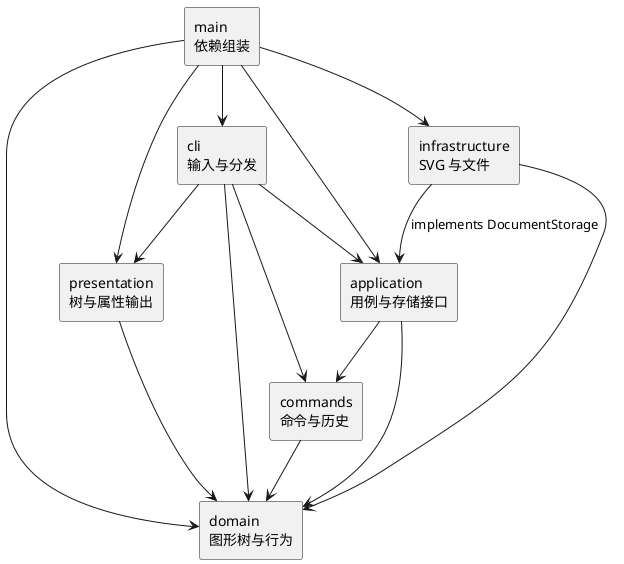

# PJ1 Phase 1：CLI SVG 编辑器

## 架构方案

### 目标与模块划分

使用 TypeScript 面向对象实现；以图形树为领域模型，以 Command 组织编辑操作。终端、文件和显示逻辑放在领域层之外。

| 目录 | 主要对象 | 职责 |
| --- | --- | --- |
| `src/domain/` | `Shape`、六种图形、`SvgDocument`、`ShapeFactory`、`Numbers` | 封装图形行为、几何校验、唯一 ID、树结构与重排 |
| `src/commands/` | `EditCommand`、各具体编辑命令、`CommandHistory` | 一个编辑命令对应一个撤销单元，管理前后快照与历史屏障 |
| `src/application/` | `Editor`、`DocumentStorage` 接口 | 当前文档、保存路径、文档用例；定义持久化边界 |
| `src/cli/` | `Tokenizer`、`Arguments`、`CommandDispatcher`、`Cli` | 引号与参数解析、命令分发、错误输出、REPL |
| `src/infrastructure/` | `SvgCodec`、`FileSvgStorage` | XML 编解码、缺失 ID 分配、文件读写 |
| `src/presentation/` | `DocumentRenderer` | 树形与属性明细输出，不修改文档 |
| `src/main.ts` | 组装入口 | 创建对象、注入存储、启动终端 |
| `test/`、`examples/` | 测试及回放脚本 | 回归验证和验收演示 |

组件图（PlantUML）：



### 设计模式及落地

**Command（必选）**：`CreateCommand`、`MoveCommand`、`GroupCommand` 等继承 `EditCommand`。`CommandDispatcher` 只解析输入并创建命令，`Editor` 通过 `CommandHistory` 执行。具体修改逻辑在命令和领域对象中；`ZOrderCommand` 用一个布尔参数表达前移或后移，避免重复类。

**Composite**：`Rect`、`Circle`、`Ellipse`、`Line`、`TextShape` 与 `Group` 共享 `Shape` 接口。容器重写 `move`、`scale`，递归调用子节点的同名方法，调用方无需按图形类型分支。容器的 `fill` 等属性写入 `<g>`，遵循 SVG 的属性继承规则。删除容器即删除整棵子树。

**Memento**：`EditCommand` 保存执行前后的深拷贝。先在候选文档上执行，全部成功后再替换当前文档并入栈；失败则丢弃候选文档，当前文档、undo 和 redo 均不变。撤销返回前快照，重做返回后快照，不依赖浮点逆运算。

**Factory**：图形类型名集中在 `ShapeFactory` 的定义表中映射到构造器；CLI 创建和 SVG 导入共用该工厂。各图形自行承担移动、缩放、克隆和摘要行为，领域层没有 `switch(tag)`。

**存储接口与依赖注入**：`Editor` 仅依赖 `DocumentStorage`，入口注入 `FileSvgStorage`；测试可换成内存替身。XML 由 [xmldom](https://github.com/xmldom/xmldom) 解析和转义，不用正则表达式解析 XML。

### 依赖方向规则

| 模块 | 允许依赖 |
| --- | --- |
| domain | 本模块；禁止文件、终端和第三方库依赖 |
| commands | 本模块、domain |
| application | 本模块、commands、domain |
| presentation | 本模块、domain |
| cli | 本模块、application、commands、domain、presentation，以及终端所需的 Node API |
| infrastructure | 本模块、application 的接口、domain，以及 Node 文件 API、XML 库 |
| main | 所有生产模块，仅用于组装 |

理由：图形与编辑语义应能脱离终端和文件系统使用；持久化适配器依赖应用定义的接口，使存储细节不会反向进入用例；显示模块只读取领域对象。

按名字分派只保留两处：`CommandDispatcher` 的命令表、`ShapeFactory` 的图形定义表。**待重构项**：后续插件化时，将这两张内置表改成可注入的注册表；本阶段不实现插件发现或动态加载。

### 变化点假设

| 可能变化 | 本阶段的准备或取舍 |
| --- | --- |
| 新增图形或 `box` 插件 | 保留 `Shape` 多态边界和统一工厂；插件注册接口留待下一阶段，避免提前建立未验证的插件系统 |
| 新增 GUI 或其他交互通道 | `Editor` 和命令类不依赖终端，可以复用；输入解析仍由各通道负责 |
| 修改撤销策略 | 历史管理集中在 `CommandHistory`；当前整树快照每条命令约占 O(N) 空间，大文档可改为局部快照或增量命令 |
| 替换文件存储 | 实现 `DocumentStorage` 接口，无需修改领域对象 |
| 扩展 SVG 范围 | 编解码集中在 `SvgCodec`；本阶段只建立六类元素的编辑语义，不承诺完整 SVG 标准支持 |
| 更改显示格式 | 结构格式集中在 `DocumentRenderer`，图形内联摘要由各图形提供 |

### 关键语义决策

- ID 大小写敏感，`set id` 不在白名单中。导入先预留全部显式 ID，再按类型生成 `rect1`、`rect2` 等名称并发出警告；也会避开根元素的显式 ID。
- `move` 为增量平移；`scale` 同乘位置和尺寸，不缩放 `stroke-width` 或文字字号。所有输入必须为有限数字，尺寸和半径非负，画布尺寸与缩放因子为正数。
- 分组按原文档的先序顺序收编，而非命令参数顺序。同父级时放在最早被选节点的位置；跨父级时放在最近公共祖先中最早涉及的分支之前，未选节点留在原容器。
- 同时选择容器与其子孙、重复选择同一节点，或向自己的子孙移动，均拒绝。解组仅允许嵌套的普通 `g`，按任务要求拒绝根级 `g`；子节点在原位置依序提升。
- SVG 后出现的同级节点覆盖先出现的节点，因此 `front` 移至同级末尾，`back` 移至开头；`addto` 追加到目标容器末尾。
- 成功执行 `init/read/save` 或修改画布尺寸后清空历史，并对 undo、redo 报 `undo not allowed after io command`。下一次成功编辑解除屏障；`canvas` 查询、显示和失败命令不影响历史。
- `save` 首次需要路径，之后复用最近成功读入或保存的路径。文件写入同目录临时文件，再重命名替换目标；失败时清理临时文件并保留编辑器状态。
- 空行与整行 `#` 注释忽略；不支持行尾注释，以免破坏颜色参数。双引号支持空文本、空格，以及 `\"`、`\\`、`\n`、`\r`、`\t` 转义。`in` 尾缀只识别未加引号的关键字。

## 过程记录

本次使用 Codex 辅助梳理方案、生成实现并运行测试。以下保留关键迭代摘要；没有将 AI 生成的实现或验证结果记为人工独立完成。

| 迭代 | 发现与调整 | 确认方式 |
| --- | --- | --- |
| 需求与方案 | 从任务文件确认 TypeScript、Command、Composite、IO 历史屏障和根级容器禁止解组，先建立模块边界 | 对照 `phase_cli_1.md`，提交工程骨架和初始方案 |
| 图形与命令 | 撤销测试暴露 `Group.clone()` 只复制容器、复用子节点的缺陷；改为逐个克隆子节点 | 深层快照隔离、撤销重做、递归变换溢出回滚测试通过 |
| 导入与输入 | 缺失 ID 的即时编号可能与文件后部的显式 ID 冲突；采用两遍扫描。带引号的 `"in"` 必须保留为文字 | 导入冲突测试和带引号参数测试通过 |
| 验收与收尾 | 补齐全部命令、文件异常、真实终端及模块依赖检查，记录实际支持范围 | 自动化测试、流程图回放、交互终端检查与覆盖率报告 |

Git 按实际开发顺序提交：工程与方案 → 图形树 → 事务命令与历史 → CLI 与 SVG IO → 验收测试及示例 → 最终文档。没有回填日期或构造虚假讨论记录。

## 一致性自查

### 模块划分

实际生产目录与初始方案一致。补充对象包括领域数值校验类 `Numbers`、CLI 参数类 `Arguments/Token/Tokenizer` 及存储接口 `DocumentStorage`，均放在原有职责边界内；没有新增计划之外的生产模块。

修订记录：初始图示未展开 CLI 对领域工厂、数值校验以及入口组装的直接依赖，最终组件图和依赖表已补全；前移和后移共用 `ZOrderCommand`；容器克隆修正为递归深拷贝。

### 依赖方向

`test/architecture.test.ts` 检查全部六个生产模块的静态 import，并检查导出类名与文件名一致；同时禁止领域、命令、应用和显示层导入外部 IO 库。检查通过。

抽样核对：

- `Group.ts` 仅依赖本层的 `Shape/Numbers`，通过多态递归移动与缩放。
- `MoveCommand.ts` 仅依赖 `EditCommand/SvgDocument`，不读文件或终端。
- `Editor.ts` 依赖 `DocumentStorage` 接口，没有导入 `FileSvgStorage`。
- `FileSvgStorage.ts` 实现应用接口，将文件操作和 XML 逻辑隔离。
- `DocumentRenderer.ts` 只依赖领域对象，不执行编辑。

没有发现违反当前依赖规则的静态导入。保留的两处名字分派已在方案中列为后续插件化的待重构点。

## 功能完整性和质量保证手段

### 功能验收矩阵

| 功能 | 实现与验证 |
| --- | --- |
| init/read/save/canvas | 默认尺寸、单独指定宽度、路径复用、带空格中文路径、失败 IO、历史屏障 |
| 六种 create 与 `in` | rect/circle/ellipse/line/text/g；可选颜色省略时不输出属性；直接创建到容器 |
| move/scale | 叶子与多级容器、所有几何字段、浮点与负坐标、非正因子和数值溢出 |
| set | 公共属性、各类几何属性、文字内容、空文字、白名单拒绝与样式克隆 |
| delete | 删除整棵子树，一次撤销恢复结构和内容 |
| group/ungroup/addto | 原顺序、跨父级收编、解组位置、循环引用拒绝、根级解组拒绝 |
| front/back | 同级绘制顺序以及撤销恢复 |
| tree/show/help | 全树与子树、内联几何、父容器、文字与所有命令语法 |
| undo/redo | 每条命令一个单元、新编辑清空 redo、失败不清空 redo、IO 屏障 |
| SVG 互操作 | XML 特殊字符转义、中文、唯一 ID、缺 ID 警告、读写回环、格式错误拒绝 |
| CLI 交互 | `svg>`、逐行命令、整行注释、统一单行 `error:`、脚本回放、exit/quit 与 EOF |
| 架构质量 | 静态模块依赖检查、类名和文件名一致、严格类型检查 |

### 可复现验证

在项目根目录执行：

```sh
npm ci
npm run check
npm run test:coverage
npm run cli < examples/flowchart.commands
```

验收日期为 2026-10-24，环境为 Node.js 24.21.0；项目要求 Node.js 22 或更新版本。`npm run check` 包含严格 TypeScript 编译和 **59 项自动化测试，全部通过**。覆盖率由 c8 测量，本次行覆盖率为 **99.26%**，分支覆盖率为 **95.71%**，函数覆盖率为 **99.55%**。真实文件测试使用临时目录并在结束后清理；交互终端另外检查过提示符、中文输入、容器移动和撤销。

质量依据来自行为断言，而不只是覆盖率：例如失败命令前后比较结构并继续 redo；中途数值溢出时检查前面已处理的子图形也回滚；读写回环比较每个元素的属性、文字和层级。覆盖率未覆盖到的部分主要为防御性异常分支及非自动化的终端提示分支。

持续集成在 `.github/workflows/check.yml` 中配置，每次 push 或 PR 在 Node.js 22 上安装锁定依赖并执行 `npm run check`。自动化结果不代表已验证所有外部 SVG 或所有操作系统的文件系统行为。

### 使用方法与范围

```sh
npm run cli
# 或编译后运行
npm run build
node dist/main.js
```

最小会话：

```text
init 800 600
create g scene
create rect r1 10 20 100 50 #4a90d9 in scene
create text t1 30 50 "Hello SVG" in scene
move scene 20 10
undo
redo
tree
save demo.svg
exit
```

完整示例位于 `examples/flowchart.commands`，输出为可在浏览器打开的 `examples/flowchart.svg`。`examples/other.svg` 对应任务中的外部导入示例。

范围与限制：

- 本阶段只编辑六种内置元素；`create box` 和未知类型按要求报错。`data-kind="box"` 的外部 `<g>` 作为普通容器读取，不启用插件语义。
- 外部 SVG 的附加属性如 `font-size`、`text-anchor`、`opacity`、`transform` 会保留；CLI `set` 仍严格使用任务白名单。几何编辑在元素本地坐标中执行，不解析和烘焙外部 transform；跨带变换父级重分组不保证屏幕位置不变。
- 不支持 path、defs/use、嵌套 svg、tspan、DOCTYPE 和百分比尺寸；遇到不支持的图形结构会拒绝导入，不静默丢弃图形。注释与 XML 格式化不会原样保留。
- 支持根尺寸数字或 px，缺省时由 viewBox 或默认值补齐。保留导入 viewBox；主动修改画布后重置为 `0 0 w h`。
- 未设置历史长度上限；快照适合课程规模文档，不适合超大图形库。
