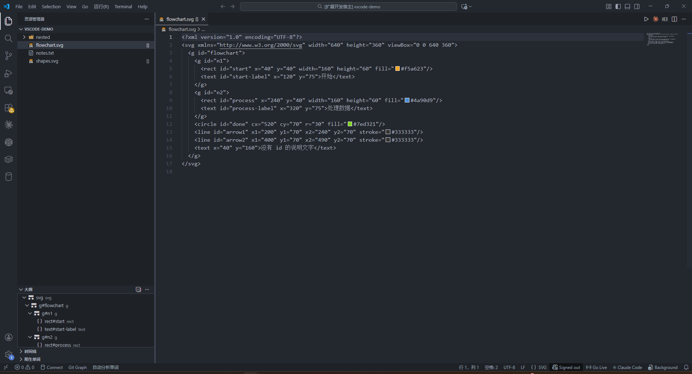
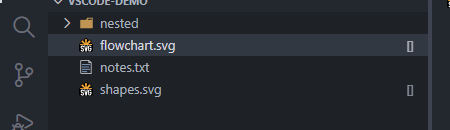
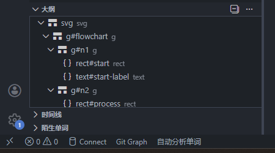

# PJ1 Phase 2 测试与验证提交材料

## 测试总览

在项目根目录执行：

```sh
npm ci
npm run check          # build + typecheck(src/plugins/tests) + 102 项 CLI 测试
npm run check:extension # extension 编译 + 6 项 Outline 测试
```

当前结果：**CLI 102 / 102 通过，VSCode 扩展 6 / 6 通过**。CLI 测试包含 Phase 1 的 59 项回归。

`npm run typecheck` 使用 `tsconfig.plugins.json` 同时检查 `src/`、`plugins/` 和 `test/`，避免插件与测试只在运行时被 `tsx` 类型擦除。

## 插件与加载器测试

- `test/plugin.test.ts`：同一 `PluginContext` 注册 `stats` 与 `box`；`box` 创建派生 `id-rect` / `id-label`；`stats` 输出；缺失模块与激活异常回滚。
- `test/loader.test.ts`：
  - manifest 声明与实际注册不一致 → `plugin manifest mismatch`，shape 回滚；
  - 重复命令注册 → `duplicate registration: commands/<name>`，当前插件的 decorator 一并回滚，先前插件保留；
  - 激活中途抛错 → shape 注册回滚；
  - 顶层模块缺失 → `plugin not found`；
  - 模块存在但依赖缺失 → `plugin failed to load`（不误报 not found）；
  - 无默认导出、三类非法配置、`enabled: false`、`options` 传递、代码装配 `loadModule`；
  - 插件目录 `package.json` 的 `contributes` 与包名被读取，声明不一致时回滚。
- `test/dir.test.ts`：
  - `formatEntries` 的目录/文件/特殊项排序、隐藏项、空目录；
  - 测试替身 `DirectoryAccess` 与固定 `cwd`；
  - 真实 `FileSystemDirectoryAccess` + 临时目录；
  - 读取失败消息；
  - 代码装配与配置装配对同一目录输出逐字节一致；
  - `dir` 在未 `init` 时可用，成功/失败均不改变文档和 undo 历史。
- `test/box.test.ts`：
  - `create box`、`set fill`、`set label`、`stats`；
  - `data-kind="box"` 编码、插件在读回时识别；
  - 未装插件时降级为普通 `g` 并警告，`label` 报 `unknown attribute`；
  - 缺失/类型错误的必要子部件拒绝整次读入；
  - `ungroup`、删除/移走必要子部件被拒绝；
  - 重复 id 原子失败；嵌套 box 与额外子节点可读写。
- `test/tree-decorator.test.ts`：
  - 保存 → 编辑 → `undo` 回到保存点 → `redo`，`*` 的出现/消失；
  - `(box)` 与 `*` 按注册顺序组合；
  - 祖先传播；
  - 两个装饰器实例状态隔离。
- `test/attribute.test.ts`：第一个匹配处理器生效；部分修改后抛错整体回滚；无处理器时回退 Phase 1 白名单；box 的 `fill`/`label` 各自为一个 undo 单元。
- `test/assembly.test.ts`：同一混合会话（`box`/`stats`/`dir`/`tree`/`save`）在代码装配与配置装配下输出逐字节一致。
- `test/stats.test.ts`：空 `g` 仍计为容器、叶子顺序、空文档、`help` 中只有加载后才出现、`stats` 不进入 undo。
- `test/transcript.test.ts`：读取 `doc/transcript/cli-1.txt`、`cli-2-box.txt`、`cli-3-new.txt`，与对应 `.expected.txt` 逐条比较；`cli-2` 是 Phase 1 §6.1 的 box 会话。

## 功能兼容性验证

Phase 1 的 `init`/`read`/`save`/`canvas`、六类图形、`move`/`scale`、`group`/`ungroup`/`addto`、`front`/`back`、`tree`/`show`/`help`、`undo`/`redo` 和 SVG 读写回归测试全部通过。未加载可选插件时，内置命令继续可用；执行 `stats`/`dir` 得到 `error: unknown command`。

配置装配：

```sh
npx tsx src/main.ts --config plugins.config.json
```

示例会话：

```text
create box b 0 0 50 20 "Hi"
set b fill red
set b label "Hello"
stats
dir
tree
```

输出包含 `g#b (box)`、内部 `rect`/`text`、`rect: 1  text: 1  (total 2, containers 1)`；`dir` 使用 CLI 进程当前目录，不随 `read`/`save` 改变。

## VSCode 扩展验证

扩展源码在 `extension/src/`：`outline.ts` 是可独立测试的 SVG → 带源码偏移的 Outline 解析器；`extension.ts` 注册 `DocumentSymbolProvider` 与 `FileDecorationProvider`。

本机运行步骤：

```powershell
cd extension
npm install
npm run compile
cd ..
code --new-window --extensionDevelopmentPath=".\extension" ".\examples\vscode-demo"
```

本机 Extension Development Host 截图（不是附件参考图）：



*图 1：Explorer 中 `.svg` 文件显示 `[]`，编辑器显示 SVG 源码，下方原生 Outline 显示嵌套层级。*



*图 2：`flowchart.svg`、`shapes.svg` 右侧显示 `[]`；`notes.txt` 和目录没有标记。*



*图 3：Outline 显示 `svg → g#flowchart → g#n1 → rect#start / text#start-label`，有 id 时显示 `tag#id`，无 id 时显示标签名。*

验证项目：

- `.svg` 文件在 Explorer 显示 `[]` badge；文件名和内容不变；非 SVG 文件和目录无 badge。
- Outline 显示根元素、容器和叶子，嵌套 children 正确；带 id 的节点显示 `tag#id`，无 id 的节点显示标签名。
- 点击 Outline 节点定位到对应源码。
- 编辑文本后 VSCode 重新调用 provider，大纲更新。
- XML 暂时不完整时返回空大纲，扩展不崩溃。
- `extension/test/outline.test.cjs` 覆盖嵌套分组、无 id、编辑更新、CRLF、属性中的 `>`、自闭合、注释、非法/不完整 XML。

`examples/vscode-demo/.vscode/settings.json` 中的 `svgOutline.demo` 只用于可复现截图：扩展会把 SVG 以文本编辑器打开并聚焦/展开 Outline。正常使用保持默认 `false`，不影响 badge 和大纲。

## 复现命令

```powershell
npm ci
npm run check
npm run check:extension
npm run metrics
cd extension
npm install
npm run compile
```

依赖目录、编译产物和覆盖率目录不纳入提交。扩展点清单、两种装配方式、重构前后架构图、ADR 和 AI 协作检查记录见 `doc/README.md` 与 `doc/adr/`；指标见 `docs/metrics/generated.txt`。
